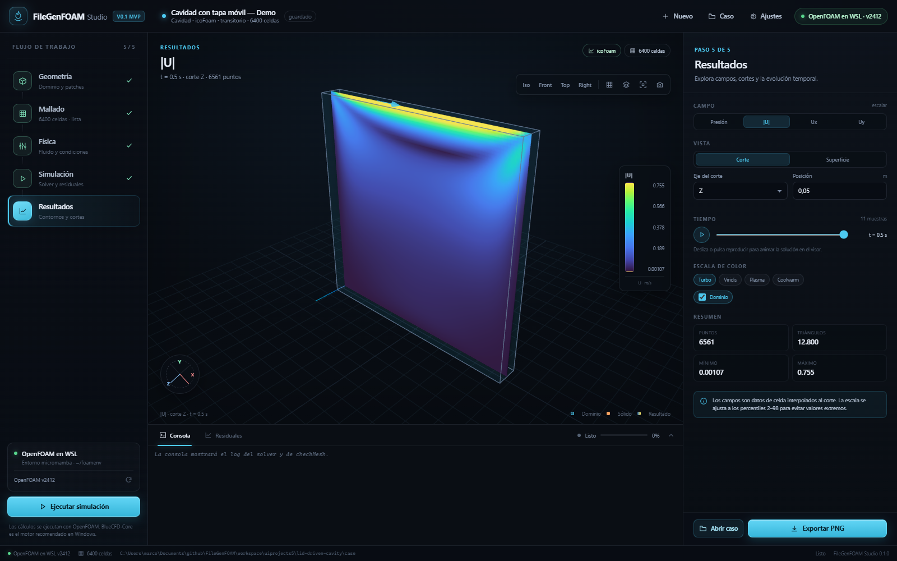
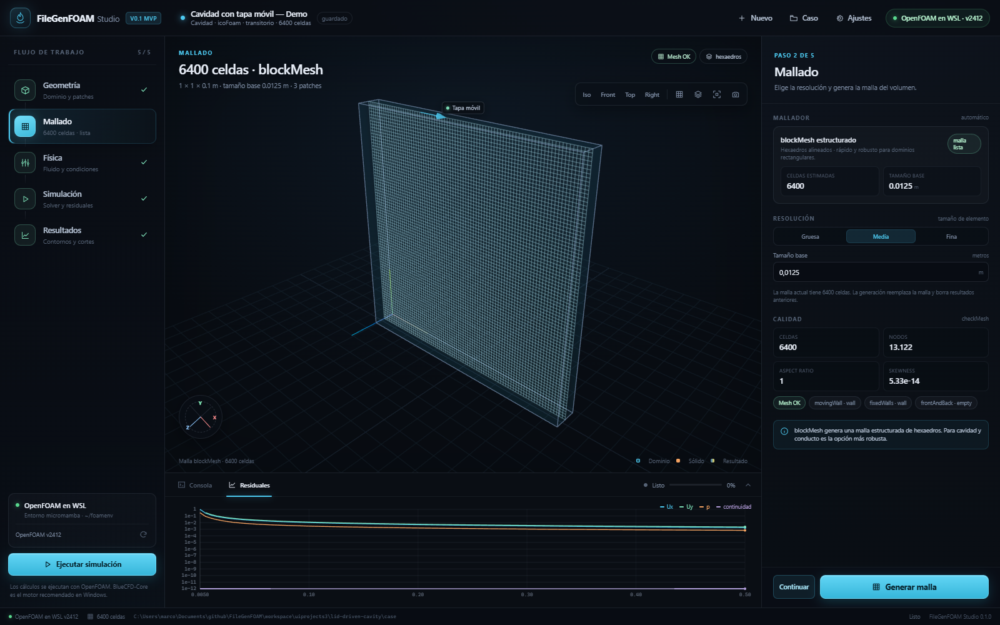
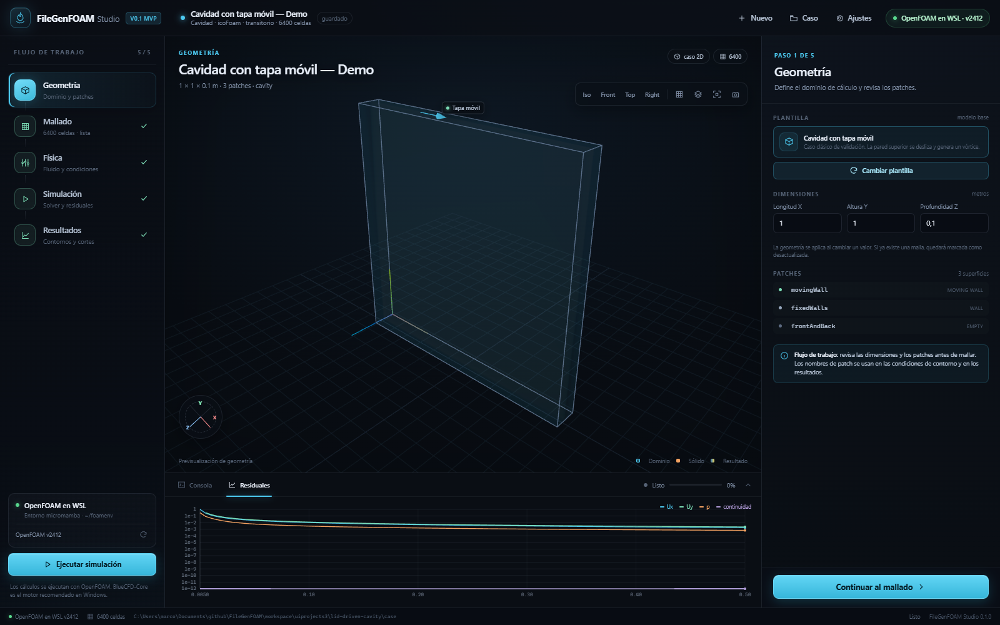
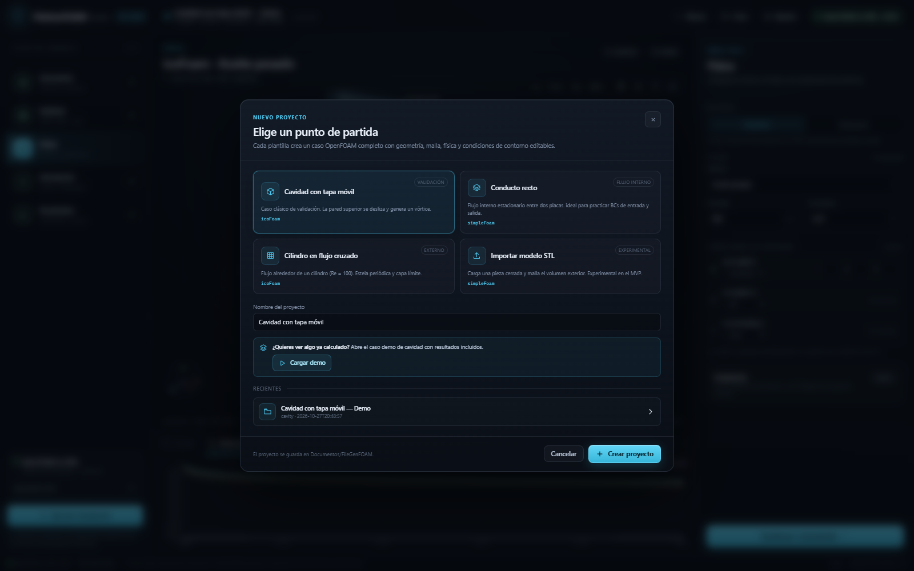

# FileGenFOAM Studio

**Un banco de trabajo CFD de escritorio, guiado y visual, para OpenFOAM.**

Modelo 3D → Mallado → Física → Simulación → Resultados, en una sola ventana. La app detecta
BlueCFD-Core en Windows (o OpenFOAM en WSL como alternativa de desarrollo), genera el caso,
lanza el solver, dibuja la convergencia en vivo y permite explorar presión y velocidad en 3D.



## Qué incluye el MVP

- Flujo de trabajo en cinco pasos con barra lateral, panel de propiedades contextual y visor 3D.
- Plantillas guiadas: **cavidad con tapa móvil**, **conducto recto** y **cilindro en flujo cruzado**.
- Importación de STL con previsualización 3D (el mallado de STL queda para la siguiente iteración).
- Mallado estructurado con `blockMesh` para cavidad/conducto y mallado con **gmsh** + `gmshToFoam`
  para el cilindro, con grupos físicos nombrados y `checkMesh`.
- Casos OpenFOAM generados desde cero: `0/U`, `0/p`, `constant/*`, `system/controlDict`,
  `fvSchemes`, `fvSolution`, `blockMeshDict`.
- Solvers `icoFoam` (transitorio) y `simpleFoam` (estacionario), régimen laminar.
- Log del solver en vivo, residuales, progreso, `checkMesh` y botón de parada.
- Postproceso integrado: campos `p`, `|U|`, `Ux`, `Uy`; cortes X/Y/Z y superficie exterior;
  selector temporal, animación, colormaps y exportación PNG.
- Caso demo **precalculado**: se abre la primera vez y funciona sin tener OpenFOAM instalado.
- Runtime BlueCFD-Core (principal) y WSL/micromamba (desarrollo y CI).
- Persistencia en `project.json` y carpeta de caso OpenFOAM inspeccionable.





## Instalación

Requisitos: Windows 10/11, Python 3.10+, WebView2 (incluido en Windows 11). En Linux/macOS se puede
usar el modo navegador, aunque el objetivo del MVP es Windows + BlueCFD.

Con [uv](https://docs.astral.sh/uv/) (recomendado):

```powershell
uv venv --python 3.12
uv pip install -r requirements.txt
.venv\Scripts\python app.py
```

La forma más rápida en Windows es ejecutar **`run.bat`**: crea el entorno e instala las
dependencias la primera vez. También puedes usar Python normal:

```powershell
py -3.12 -m venv .venv
.venv\Scripts\pip install -r requirements.txt
.venv\Scripts\python app.py
```

La primera vez se copia el demo de cavidad a `Documentos\FileGenFOAM\lid-driven-cavity` y se abre en
la ventana nativa. También puedes arrancar solo el servidor local y usar el navegador:

```powershell
.venv\Scripts\python app.py --no-window --port 8765
```

## Motor CFD

### BlueCFD-Core (recomendado en Windows)

1. Descarga BlueCFD-Core desde <https://bluecfd.github.io/Core/>.
2. Para máxima compatibilidad con el MVP usa **BlueCFD-Core 2020-1** (OpenFOAM 8).
3. Instala en una ruta **sin espacios**, por ejemplo `C:\blueCFD-Core\2020-1`.
4. Abre FileGenFOAM Studio; la app lo detecta al arrancar. Si no aparece, abre **Ajustes → Motor CFD**
   y escribe la ruta de instalación o de `msys64\usr\bin\bash.exe`.

BlueCFD-Core **2024-1** (OpenFOAM 12) también se detecta. Los casos transitorios usan `icoFoam`; los
estacionarios se ejecutan con `foamRun -solver incompressibleFluid` y se consideran **experimentales**
en este MVP. La app avisa en el panel de simulación.

Detalles de instalación, variables de entorno y diagnóstico: [`docs/BLUECFD.md`](docs/BLUECFD.md).
También puedes ejecutar `python scripts/probe_bluecfd.py --json` para ver qué instalaciones detecta
el sistema sin abrir la aplicación.

### WSL (alternativa para desarrollo)

El repositorio incluye un bootstrap sin privilegios de administrador que instala OpenFOAM 2412 en un
entorno micromamba dentro de WSL:

```powershell
wsl -e bash -lc "sed -i 's/\r$//' /mnt/c/Users/TU_USUARIO/Documents/github/FileGenFOAM/scripts/bootstrap_wsl_foam.sh && bash /mnt/c/Users/TU_USUARIO/Documents/github/FileGenFOAM/scripts/bootstrap_wsl_foam.sh"
```

Después, la app detecta automáticamente el entorno (`~/foamenv`) o puedes indicarlo en Ajustes.

## Uso rápido

1. **Geometría**: elige una plantilla, ajusta dimensiones y revisa los patches.
2. **Mallado**: selecciona gruesa/media/fina y pulsa **Generar malla**. Se ejecuta `blockMesh` o
   `gmsh` + `gmshToFoam` y `checkMesh`.
3. **Física**: elige transitorio o estacionario, fluido, viscosidad y condiciones de contorno.
4. **Simulación**: pulsa **Ejecutar**. La consola y la pestaña **Residuales** se actualizan en vivo.
5. **Resultados**: elige campo, corte, tiempo y colormap. Puedes animar la solución y exportar PNG.

El caso demo ya trae resultados: al abrirlo se muestra directamente la vista de resultados. Para
volver a calcularlo, ve a **Simulación → Ejecutar**; se borran los resultados anteriores y se lanza
`icoFoam` de nuevo.

## Estructura

```
app.py                       lanzador de escritorio
run.bat                      instalación + arranque en Windows
foamstudio/                  backend (modelo, casos, malla, runtime, jobs, VTK, API)
web/                         UI (HTML/CSS/JS + three.js vendorizado)
examples/lid-driven-cavity/  caso demo precalculado
docs/PLAN.md                 plan de trabajo y roadmap
docs/BLUECFD.md              guía del runtime BlueCFD
docs/screenshots/            capturas de la UI
tests/                       tests de modelo, parser, API y postproceso
scripts/                     bootstrap de WSL y sonda de BlueCFD
```

## Tests

```powershell
.venv\Scripts\pip install -r requirements-dev.txt
.venv\Scripts\python -m pytest -q
```

La suite cubre el generador de casos, el modelo de proyecto, el parser de residuales, el parser de
`checkMesh`, la API y la lectura VTK del demo. Para pruebas visuales se usó Playwright con Edge
(`python -m playwright install chromium` solo es necesario si no hay Edge instalado).

## Limitaciones conocidas (MVP)

- Flujo **laminar incompresible**; turbulencia (k-ω SST) y funciones de pared están en roadmap.
- Plantillas 2D extruidas y mallas relativamente modestas; no sustituye a un preprocesador CAD/CAE
  completo.
- STL: importación y previsualización 3D, pero el mallado del volumen exterior todavía no está activo.
- Ejecución **serial**; no hay paralelización con MPI ni batch de parámetros.
- La integración con BlueCFD-Core 2020-1 (OpenFOAM 8) está validada en Windows con `blockMesh`,
  `icoFoam` y `simpleFoam`. El adaptador para BlueCFD-Core 2024-1 (OpenFOAM 12, `foamRun`) sigue
  siendo experimental.
- El empaquetado en un `.exe` firmado y la autoactualización son trabajo posterior.

## Roadmap

Consulta [`docs/PLAN.md`](docs/PLAN.md): turbulencia, STL/snappyHexMesh, coeficientes de fuerza,
multifase, transferencia de calor, informes PDF y empaquetado.

## Créditos

OpenFOAM® es una marca registrada de OpenCFD Ltd. BlueCFD-Core es un proyecto independiente.
gmsh, three.js, VTK/PyVista y Flask pertenecen a sus respectivos autores.

El script original `FileGenFOAM.py` (generador de la carpeta `0/` para
`fluentMeshToFoam`) se conserva en la raíz como legado; la aplicación nueva vive en
`foamstudio/` y `web/`.
